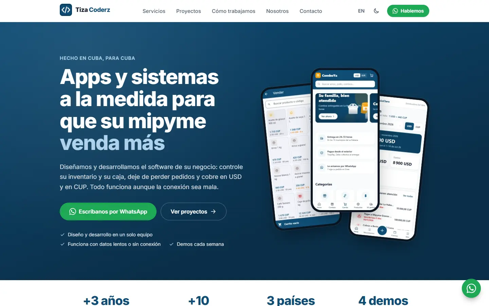
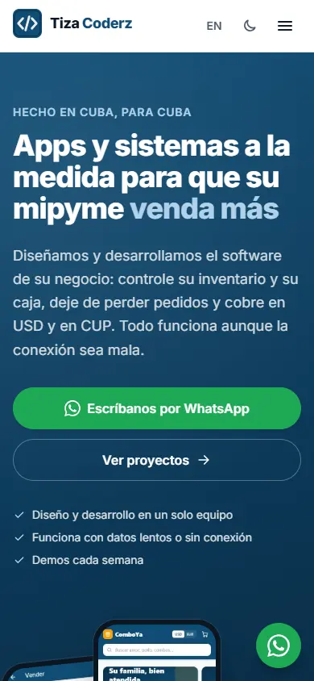
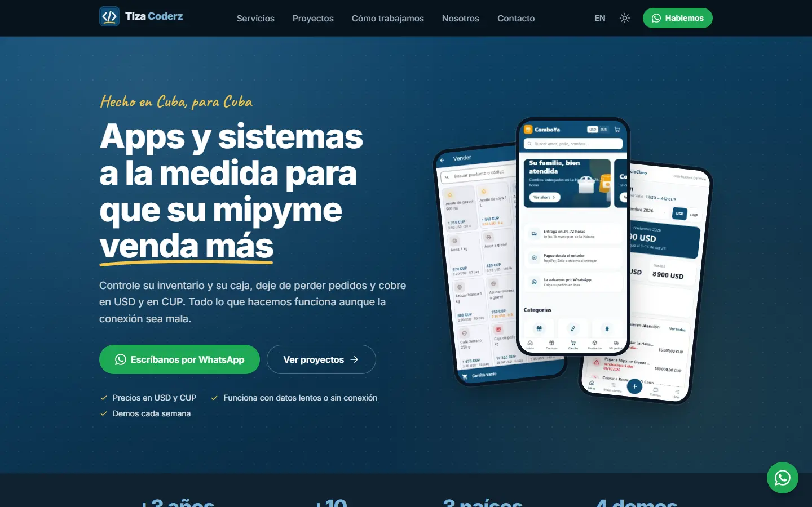
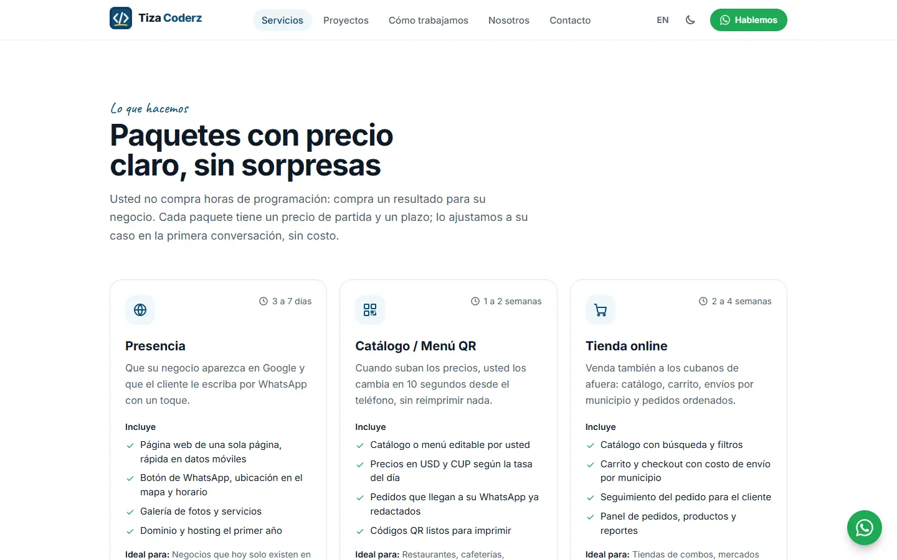
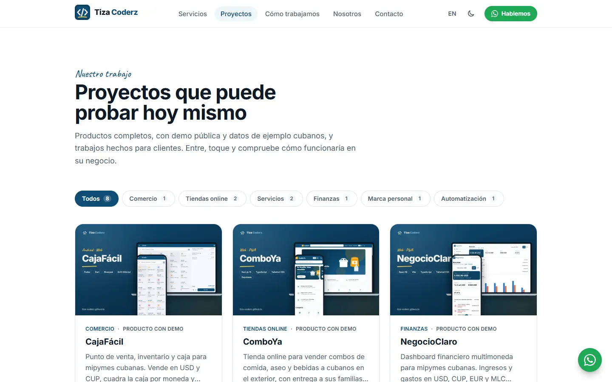
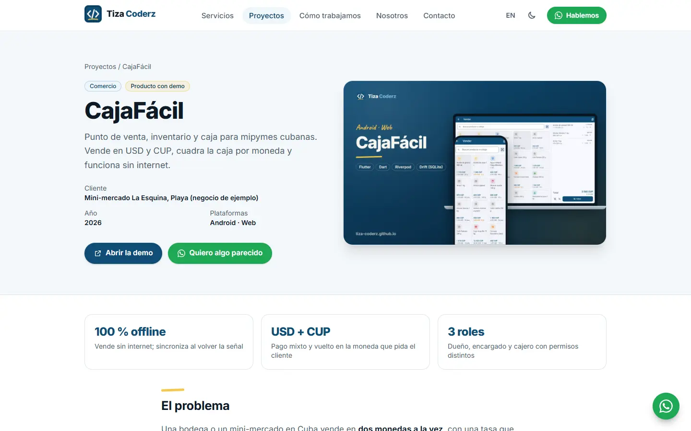
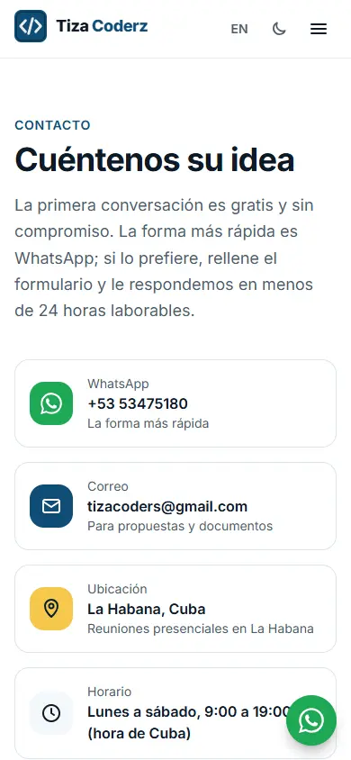
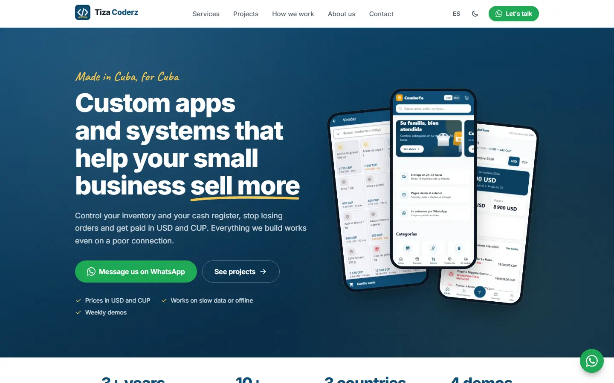

<div align="center">


# Tiza Coderz · Web corporativa

**Apps, webs y sistemas a la medida para mipymes cubanas.**
_Del boceto en tiza al software que vende._

[](https://github.com/Tiza-Coderz/tiza-coderz.github.io/actions/workflows/ci.yml)
[](https://github.com/Tiza-Coderz/tiza-coderz.github.io/actions/workflows/deploy.yml)


**[▶ Ver la web en vivo](https://tiza-coderz.github.io/)** · [English summary](#english-summary)

</div>

---

## El problema de negocio

Un dueño de mipyme en Cuba que busca quien le haga una app o un sistema no compra tecnología: compra **confianza**. Necesita ver que el equipo entiende su realidad (dos monedas, tasa que cambia cada semana, apagones, datos caros, clientes por WhatsApp) y que ya ha resuelto problemas parecidos.

Esta web es la **oficina en línea del estudio Tiza Coderz**. Su trabajo es convertir visitas en conversaciones por WhatsApp:

- Explica **qué hacemos**, del diseño de marca y pantallas al sistema funcionando, y cómo trabajamos. No publica precios ni plazos: cada proyecto se cotiza a la medida.
- Demuestra con **proyectos reales que el cliente puede probar** (con credenciales demo) en lugar de promesas.
- Pone **WhatsApp a un toque** en todas las páginas, con el mensaje ya redactado según lo que el visitante estaba viendo.
- Carga rápido con **datos móviles lentos** y se puede instalar como app.

## Funcionalidades

|                          |                                                                                                                                                                                                                                                                                                                |
| ------------------------ | -------------------------------------------------------------------------------------------------------------------------------------------------------------------------------------------------------------------------------------------------------------------------------------------------------------- |
| 🏠 **Portada**           | Propuesta de valor, cifras verificables, servicios destacados, casos destacados, por qué Tiza Coderz, proceso, preguntas frecuentes y llamada a la acción.                                                                                                                                                     |
| 💼 **Servicios**         | 8 servicios (Diseño UX/UI y de marca, Presencia, Catálogo/Menú QR, Tienda online, Sistema de gestión, App móvil, Automatización con IA, Mantenimiento) leídos de [`data/services.ts`](data/services.ts), con qué incluye, para quién es y botón de presupuesto por WhatsApp. Sin precios ni plazos publicados. |
| 🗂️ **Portafolio**        | Grid filtrable por sector (`?sector=ecommerce` compartible). Cada proyecto es un MDX en [`content/projects/`](content/projects) con frontmatter validado.                                                                                                                                                      |
| 📄 **Casos de estudio**  | `/proyectos/[slug]`: Problema → Solución → Resultado → Capturas → Stack → Enlaces, con credenciales demo, imagen Open Graph propia y JSON-LD.                                                                                                                                                                  |
| 🧭 **Proceso**           | 1 Conversación · 2 Propuesta · 3 Diseño · 4 Desarrollo con demos semanales · 5 Entrega y mantenimiento ([`data/process.ts`](data/process.ts)).                                                                                                                                                                 |
| 🏢 **Nosotros**          | Historia del nombre, misión, valores, equipo (fundador con [CV en PDF](public/cv.pdf)) y colaboradores.                                                                                                                                                                                                        |
| ✉️ **Contacto**          | WhatsApp, correo, ubicación y formulario accesible: envía por **Formspree** si está configurado; si no, abre **WhatsApp** o el **correo** con el mensaje ya escrito. Estados de envío, éxito y error de red/servidor.                                                                                          |
| 💬 **Testimonios**       | Array editable en [`data/testimonials.ts`](data/testimonials.ts). La sección se oculta mientras esté vacío (solo testimonios reales).                                                                                                                                                                          |
| 🌐 **ES / EN**           | Diccionarios tipados (`en.ts` debe tener las mismas claves que `es.ts`; lo comprueban TypeScript y un test). Español por defecto.                                                                                                                                                                              |
| 🌙 **Modo oscuro**       | Por preferencia del sistema o manual, sin destello al cargar.                                                                                                                                                                                                                                                  |
| 🔎 **SEO**               | Metadata por página, canonical y `hreflang`, Open Graph con imagen por página, `sitemap.xml`, `robots.txt`, JSON-LD `ProfessionalService` y `CreativeWork`.                                                                                                                                                    |
| 📱 **PWA**               | Instalable, con iconos y service worker: las páginas visitadas se pueden leer sin conexión.                                                                                                                                                                                                                    |
| 🟢 **WhatsApp flotante** | En todas las páginas.                                                                                                                                                                                                                                                                                          |

## Capturas

|                Inicio (escritorio)                 |                     Inicio (móvil)                     |                        Modo oscuro                        |
| :------------------------------------------------: | :----------------------------------------------------: | :-------------------------------------------------------: |
|  |  |        |
|                   **Servicios**                    |                     **Proyectos**                      |                    **Caso de estudio**                    |
|       |           |  |
|                **Contacto (móvil)**                |                      **English**                       |                                                           |
|   |          |                                                           |

Se regeneran con `pnpm build && pnpm shots /es/ /es/servicios/ …` (ver [Scripts](#scripts)).

## Demo y credenciales

- **Web:** <https://tiza-coderz.github.io/>
- Esta web es pública y no tiene panel de administración: el contenido se edita en `data/` y `content/` y se publica con un commit.
- Los **proyectos del portafolio** sí tienen demo con login. Las credenciales están en cada caso de estudio:

| Proyecto     | Demo                                                                        | Usuario                      | Contraseña |
| ------------ | --------------------------------------------------------------------------- | ---------------------------- | ---------- |
| CajaFácil    | [tiza-coderz.github.io/cajafacil](https://tiza-coderz.github.io/cajafacil/) | PIN `1234` o `admin@demo.cu` | `demo1234` |
| ComboYa      | [combo-ya.vercel.app](https://combo-ya.vercel.app)                          | `admin@demo.cu`              | `demo1234` |
| NegocioClaro | [negocioclaro-three.vercel.app](https://negocioclaro-three.vercel.app)      | `admin@demo.cu`              | `demo1234` |
| TallerTrack  | [tallertrack-five.vercel.app](https://tallertrack-five.vercel.app)          | `admin@demo.cu`              | `demo1234` |

## Stack

| Capa        | Tecnología                                                                                              |
| ----------- | ------------------------------------------------------------------------------------------------------- |
| Framework   | **Next.js 16** (App Router, `output: 'export'`: HTML estático, sin servidor)                            |
| Lenguaje    | **TypeScript** estricto (`strict` + `noUncheckedIndexedAccess`)                                         |
| Estilos     | **Tailwind CSS 4** con tokens de marca, Inter + Caveat autoalojadas, iconos SVG en línea                |
| Contenido   | **MDX** (`@mdx-js/mdx` + `remark-gfm`) compilado en el build, frontmatter con **gray-matter** + **Zod** |
| Formularios | **Formspree** (opcional) · WhatsApp (`wa.me`) · `mailto`                                                |
| Calidad     | ESLint, Prettier (+ orden de clases Tailwind), **Vitest** (69 tests)                                    |
| Imágenes    | **sharp** + **Playwright** (capturas, portadas, Open Graph, iconos)                                     |
| CI/CD       | GitHub Actions: lint → tipos → formato → tests → build; deploy a **GitHub Pages**                       |

Sin librerías de UI, de iconos ni de animación: la portada carga **un solo componente cliente pequeño** (menú móvil, tema e idioma), las animaciones de aparición son CSS (`animation-timeline: view()`) y el FAQ usa `<details>`.

## Arquitectura

```
content/projects/      Casos de estudio en MDX (slug.mdx = ES, slug.en.mdx = EN)
data/                  Datos editables: empresa, servicios, proceso, testimonios
public/                Imágenes WebP, Open Graph, iconos, cv.pdf, sw.js
scripts/               Capturas, portadas, iconos y optimización de imágenes
src/
├─ app/
│  ├─ (root)/          «/» → redirige a /es/ o /en/ según el navegador
│  ├─ [lang]/          Todas las páginas por idioma (layout raíz con <html lang>)
│  ├─ global-not-found 404 bilingüe
│  └─ sitemap · robots · manifest · icon
├─ components/
│  ├─ ui/              Botones, Section, Card, Badge, iconos (reutilizables)
│  ├─ layout/          Cabecera, pie, menú móvil, tema, idioma, WhatsApp flotante
│  └─ sections/        Hero, servicios, proyectos, proceso, FAQ, contacto…
├─ i18n/               config + diccionarios es.ts / en.ts tipados
└─ lib/                Lógica pura y testeada
   ├─ projects.ts        Carga, validación, orden y filtro de proyectos MDX
   ├─ contact.ts         Validación del formulario y envíos
   ├─ whatsapp.ts        Enlaces wa.me con números cubanos
   ├─ structured-data.ts JSON-LD y sitemap
   └─ seo.ts · site.ts · mdx.tsx
```

**Capas:** las páginas (`app/`) solo componen; los componentes reciben datos ya preparados; toda regla (conversión de moneda, validación, orden de proyectos, enlaces) vive en `src/lib` como funciones puras con tests. Los datos que cambia el negocio están fuera del código, en `data/` y `content/`.

## Cómo editar el contenido

| Quiero…                            | Edite                                                                                                                         |
| ---------------------------------- | ----------------------------------------------------------------------------------------------------------------------------- |
| Cambiar o añadir servicios         | [`data/services.ts`](data/services.ts)                                                                                        |
| Cambiar teléfono, correo u horario | [`data/company.ts`](data/company.ts)                                                                                          |
| Añadir un proyecto                 | `content/projects/<slug>.mdx` y `<slug>.en.mdx` + imágenes en `public/images/projects/<slug>/`, luego `pnpm marketing <slug>` |
| Añadir un testimonio real          | [`data/testimonials.ts`](data/testimonials.ts)                                                                                |
| Cambiar textos de la interfaz      | `src/i18n/dictionaries/es.ts` y `en.ts`                                                                                       |

Si algo está mal escrito (un sector que no existe, una imagen que falta, una traducción sin una clave), **los tests fallan en el CI** antes de publicar.

## Correrlo en local

Requisitos: **Node 22+** y **pnpm 10** (`corepack enable`).

```bash
git clone https://github.com/Tiza-Coderz/tiza-coderz.github.io.git
cd tiza-coderz.github.io
pnpm install
cp .env.example .env.local      # opcional
pnpm dev                        # http://localhost:3000/es/
```

### Scripts

| Comando                                                | Qué hace                                                                     |
| ------------------------------------------------------ | ---------------------------------------------------------------------------- |
| `pnpm dev`                                             | Servidor de desarrollo                                                       |
| `pnpm build`                                           | Export estático en `out/`                                                    |
| `pnpm start`                                           | Sirve `out/` en local                                                        |
| `pnpm check`                                           | Lint + tipos + formato + tests (lo mismo que el CI)                          |
| `pnpm test` / `pnpm test:coverage`                     | Tests con Vitest                                                             |
| `pnpm shots /es/ /es/servicios/ [--full]`              | Capturas de revisión (móvil/escritorio, claro/oscuro) en `.screenshots-tmp/` |
| `pnpm img <entrada> <salida.webp> --mobile\|--desktop` | Normaliza una captura a WebP                                                 |
| `pnpm capture tallertrack`                             | Captura pantallas de una demo publicada                                      |
| `pnpm marketing [slug]`                                | Genera portadas 1200×750 e imágenes Open Graph                               |
| `pnpm icons`                                           | Genera iconos de la PWA y favicon                                            |

> Los scripts de imágenes usan el **Edge o Chrome instalado** (`PW_CHANNEL=chrome` para Chrome); no descargan navegadores.

### Variables de entorno

Ver [`.env.example`](.env.example). Todas son públicas (no hay secretos):

| Variable                   | Para qué                                                |
| -------------------------- | ------------------------------------------------------- |
| `NEXT_PUBLIC_SITE_URL`     | URL pública (canonical, sitemap, Open Graph)            |
| `NEXT_PUBLIC_BASE_PATH`    | Solo si se publica en un subdirectorio                  |
| `NEXT_PUBLIC_FORMSPREE_ID` | ID del formulario de Formspree; vacío = WhatsApp/mailto |

## Desplegar GRATIS

### Opción A · GitHub Pages (la actual)

1. El repo se llama `<organización>.github.io`, así que el sitio queda en la raíz: `https://tiza-coderz.github.io/`.
2. **Settings → Pages → Source: GitHub Actions**.
3. (Opcional) **Settings → Secrets and variables → Actions → Variables**: `FORMSPREE_ID`, `SITE_URL` (si usa dominio propio) o `BASE_PATH` (si el repo tiene otro nombre, p. ej. `/tiza-web`).
4. Cada push a `main` ejecuta [`deploy.yml`](.github/workflows/deploy.yml): tests → build → publicación. Tarda unos 2 minutos.
5. Dominio propio: añada el dominio en **Settings → Pages → Custom domain**, cree el registro `CNAME` en su DNS y ponga `SITE_URL=https://sudominio.com`.

### Opción B · Vercel (plan Hobby, gratis)

El repo ya está preparado: [`vercel.json`](vercel.json) fija la instalación con pnpm, el build, la redirección de `/` según el idioma del navegador (`/en/` o `/es/`), cabeceras de seguridad y de caché. La URL pública se detecta sola (`VERCEL_PROJECT_PRODUCTION_URL`), y las vistas previas de cada PR salen con `noindex` y un `robots.txt` que bloquea a los buscadores.

**Desde la web (recomendado):**

1. Entre en [vercel.com/new](https://vercel.com/new) con su cuenta de GitHub y elija **Import** en `Tiza-Coderz/tiza-coderz.github.io`. Si la organización no aparece, pulse **Adjust GitHub App Permissions** y dé acceso al repo.
2. Deje los valores que Vercel detecta: **Framework: Next.js**, **Root Directory: `./`**. No cambie los comandos (vienen de `vercel.json`).
3. En **Settings → General → Node.js Version** compruebe que sea **22.x**.
4. En **Settings → Git → Production Branch** ponga **`main`** (por defecto Vercel usaría la rama por defecto del repo, que es `develop`).
5. (Opcional) **Settings → Environment Variables**:

   | Variable                   | Valor                                                       | Entornos            |
   | -------------------------- | ----------------------------------------------------------- | ------------------- |
   | `NEXT_PUBLIC_FORMSPREE_ID` | ID de su formulario de Formspree                            | Production, Preview |
   | `NEXT_PUBLIC_SITE_URL`     | Solo si usa dominio propio, p. ej. `https://tizacoderz.com` | Production          |

6. **Deploy**. En unos 2 minutos el sitio queda en `https://<proyecto>.vercel.app`.

A partir de ahí: cada push a `main` despliega a producción y cada PR a `develop` recibe su URL de vista previa, que Vercel comenta en el PR.

**Desde la terminal (alternativa):**

```bash
pnpm dlx vercel login          # abre el navegador para iniciar sesión
pnpm dlx vercel link           # enlaza la carpeta con un proyecto nuevo o existente
pnpm dlx vercel                # despliegue de vista previa
pnpm dlx vercel --prod         # despliegue a producción
```

**Dominio propio:** **Settings → Domains → Add** (p. ej. `tizacoderz.com`), cree en su DNS el registro que indique Vercel y ponga `NEXT_PUBLIC_SITE_URL=https://tizacoderz.com`.

> **¿GitHub Pages y Vercel a la vez?** Es posible, pero elija **uno como sitio oficial** para no duplicar contenido en Google. Si el oficial es Vercel, ponga la variable de repositorio `SITE_URL=https://<proyecto>.vercel.app` en GitHub (Settings → Variables): así las páginas de GitHub Pages apuntarán su `canonical` a Vercel. O desactive Pages en **Settings → Pages**.

### Formulario con Formspree (gratis hasta 50 envíos/mes)

1. Cree una cuenta en [formspree.io](https://formspree.io) con `tizacoders@gmail.com` y un formulario nuevo.
2. Copie el ID (`https://formspree.io/f/<ID>`) en la variable `FORMSPREE_ID` (GitHub) o `NEXT_PUBLIC_FORMSPREE_ID` (Vercel/local).
3. Sin ID, el formulario sigue funcionando: abre WhatsApp o el correo del visitante con el mensaje redactado.

## Flujo de trabajo (Git Flow)

`main` = producción · `develop` = integración · `feature/*`, `fix/*`, `docs/*`, `ci/*` → PR a `develop` · `release/vX.Y.Z` → `main` + etiqueta · `hotfix/*` desde `main`. Commits con Conventional Commits. Detalle en [CONTRIBUTING.md](CONTRIBUTING.md) y cambios en [CHANGELOG.md](CHANGELOG.md).

---

## English summary

**Tiza Coderz** is a software studio in Havana, Cuba, that builds custom apps, websites and business systems for Cuban small businesses. This repository is the studio's **corporate website**: a fast, bilingual (Spanish by default, English) static site built with **Next.js 16 (App Router, static export), TypeScript (strict), Tailwind CSS 4 and MDX**.

It presents the studio's services (including UX/UI and brand design; no public prices or timelines, every project is quoted individually), a sector-filterable portfolio of case studies written in MDX (several with live demos and demo credentials), the work process, an about page and a contact form (Formspree, or WhatsApp/mailto fallback). It includes dark mode, subtle CSS-only animations, a floating WhatsApp button, full technical SEO (per-page metadata, Open Graph images, sitemap, robots, `ProfessionalService` JSON-LD) and an installable PWA with offline reading.

Content lives in `data/` and `content/`, validated with Zod; business logic lives in pure, tested functions in `src/lib` (69 Vitest tests). CI runs lint, type checks, formatting, tests and build on every PR; merging to `main` deploys to **GitHub Pages** (Vercel config included). Live site: <https://tiza-coderz.github.io/>.
